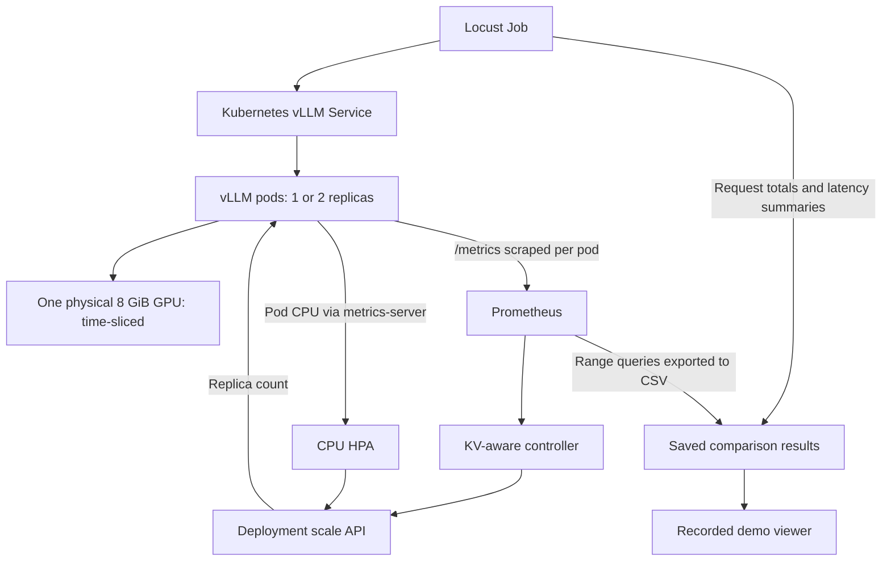

# KV-Aware Autoscaling for GPU-Efficient LLM Inference

A Kubernetes prototype that compares inference-aware vLLM autoscaling with a CPU-based Horizontal Pod Autoscaler (HPA), using real in-cluster Locust traffic and recorded Prometheus metrics.

The recorded setup uses **one physical NVIDIA GPU with 8 GiB of VRAM**. Two time-sliced vLLM pods share that device; two shared allocations do not provide two GPUs or twice the compute capacity.

## The problem

CPU utilization measures host-side activity, but LLM serving also depends on GPU execution and memory available for active token sequences. The KV cache stores attention keys and values for those sequences. Longer contexts and more concurrent requests can increase KV-cache occupancy even when CPU utilization remains modest. Requests can also wait for inference scheduling while CPU utilization gives little indication of the backlog.

KV-cache occupancy and queued-request counts therefore provide signals closer to inference pressure. Neither alone guarantees a latency improvement: model startup, scheduling, GPU contention, and the workload also affect the result. This project asks whether these signals can drive a working Kubernetes scaling loop, and how its behavior compares with CPU HPA under the same workload.

## Architecture and measurement pipeline

Only one autoscaling policy controls the Deployment at a time.

1. Locust sends chat-completion requests to the in-cluster Service at `http://vllm.default.svc.cluster.local:8000`. The Service routes traffic to serving pods, which execute inference on the shared GPU.
2. The Service declares Prometheus scrape annotations for port 8000 and `/metrics`. Recorded per-instance metrics provide KV-cache usage, waiting/running requests, throughput, latency histograms, and scrape-target health.
3. The KV-aware controller queries Prometheus and patches the Deployment scale interface. CPU HPA uses CPU resource utilization via metrics-server; it does not consume the custom controller's Prometheus signals.
4. The comparison runner saves timestamped Locust logs, controller output, an HPA snapshot, and run windows. The exporter queries Prometheus over each window at five-second steps and saves CSV samples plus metadata.
5. The demo data preparation script verifies the final Locust summaries and bundles the paired logs and metric series for the recorded viewer. Overall Locust latency percentiles and rolling Prometheus histogram percentiles are distinct measurements.

## Hardware and serving configuration

The one-GPU, 8 GiB hardware description is the recorded experiment setup, also documented in [the demo README](demo/README.md); manifests configure sharing but do not inventory physical VRAM.

[NVIDIA time-slicing configuration](k8s/gpu-time-slicing.yaml) advertises two allocations per GPU with `renameByDefault: true`. Each vLLM pod requests one `nvidia.com/gpu.shared` allocation. Both processes compete for the same GPU time and memory.

Both serving manifests, [KV-aware](k8s/vllm.yaml) and [CPU baseline](k8s/vllm-hpa.yaml), configure:

- NVIDIA runtime and `vllm/vllm-openai:v0.32.0`.
- Model `Qwen/Qwen2.5-0.5B-Instruct`, maximum model length 1024, and eager execution.
- `--gpu-memory-utilization 0.38` and an explicit `--kv-cache-memory-bytes 134217728` (128 MiB) budget per pod.
- A readiness probe against `/health` on port 8000 every 10 seconds.
- Rolling updates with `maxSurge: 0` and `maxUnavailable: 1`.

The CPU baseline additionally requests `100m` CPU per pod. The checked-in KV serving manifest specifies two initial replicas, but the comparison runner applies it with one initial replica; the HPA serving manifest specifies one.

## Autoscaling policies

### KV-aware controller

[The controller](autoscaler/controller.py) and [its manifest](k8s/autoscaler.yaml) configure a five-second polling interval and a one-to-two-replica decision range. Scale-up requires the same signal to meet its threshold for two consecutive observations:

| Signal | Aggregation | Scale-up threshold |
|---|---|---:|
| KV-cache occupancy | Maximum across serving instances | ≥ 0.30 (30%) |
| Waiting requests | Sum across instances | ≥ 1 |
| Running requests | Sum across instances | ≥ 6 |
| Queue latency p95 | Histogram quantile over a 30-second rate window | ≥ 1.0 s |

Scale-down requires queue p95 ≤ 0.20 s, KV occupancy < 0.15, no waiting requests, and at most one running request continuously for 120 seconds. Missing queue-latency data prevents scale-down. When healthy Prometheus target count differs from desired replicas, the controller resets its signal counters and waits; scrape health is not a Kubernetes Ready timestamp.

The dedicated ServiceAccount can only get and patch the named `vllm` Deployment's scale subresource through its Role. The code defaults to dry-run, while the deployment manifest explicitly sets `DRY_RUN=false`.

### CPU HPA baseline

[The HPA manifest](k8s/hpa-cpu.yaml) scales between one and two replicas at a target average CPU utilization of 70%, relative to the baseline's `100m` CPU request per pod. This is not 70% of the laptop's total CPU. Scale-up stabilization is zero seconds; scale-down stabilization is 120 seconds.

## Experiment design

The recorded experiment runs on local K3s in Ubuntu under WSL2. Both [KV](k8s/locust-autoscale.yaml) and [CPU](k8s/locust-hpa.yaml) Locust Jobs use `locustio/locust:2.46.0` and the same [workload](locust/autoscale_stress.py):

| Stage | Duration | Locust users |
|---|---:|---:|
| Initial load | 1 minute | 1 |
| Burst | 5 minutes | 8 |
| Recovery | 2 minutes | 1 |

Each request includes a varying identifier and 30 repeated context items, asks for a short explanation, and caps generated output at 128 tokens. Clients wait 0.1–0.3 seconds between requests, close connections after requests, and use a 90-second timeout. This is a closed-loop user workload: response time affects how many requests clients can finish during the run.

[The comparison runner](demo/public/fresh-run.sh) disables the other policy, resets serving to one replica, and waits for rollout before enabling the selected policy. It runs KV-aware first and CPU HPA second. Client traffic stays inside Kubernetes; the optional host port-forward is only for Prometheus access. After completion, CPU HPA remains active and the KV controller is paused.

## Latest verified results

The latest complete paired comparison is stored in the [paired run evidence](results/fresh-20261021t100502z/) and used by the current demo. Both logs record completion of the full workload.

| Policy | Completed requests* | Failures | Mean | Median | p95 | Approx. p99 |
|---|---:|---:|---:|---:|---:|---:|
| KV-aware | 800 | 0 | 2.983 s | 3.1 s | 3.4 s | 3.5 s |
| CPU HPA | 666 | 1 timeout† | 3.549 s | 3.1 s | 3.4 s | 48 s |

*Counts are Locust's total recorded requests, including failures: CPU HPA has 665 successes plus one failed request. Latencies come from the final aggregated summaries, converted from milliseconds to seconds. Percentiles, including the p99 values above, are Locust's approximations from this latest pair.

†The CPU log reports one `HTTP 0` failure and a maximum duration of 90.021 s, consistent with the workload's 90-second client timeout; it does not preserve a more specific exception type.

For this measured pair, KV-aware recorded more requests and a lower mean and p99 latency; **median and p95 were equal**. This supports a working inference-aware scaling loop and a favorable result for this workload. A single latest pair, sequential execution, and two pods contending for one GPU do not establish general superiority, faster scaling in every case, or gains from adding physical GPUs. Older trials remain in the repository as historical evidence and are not mixed into this table.

### Evidence and interpretation

- [KV Locust log](results/fresh-20261021t100502z/locust-kv-20261021t100502z.log) and [CPU Locust log](results/fresh-20261021t100502z/locust-cpu-20261021t100502z.log): final request totals, failures, means, medians, and percentile summaries.
- [Run windows](results/fresh-20261021t100502z/run-windows.json): UTC export windows for each policy.
- [KV Prometheus CSV](results/fresh-20261021t100502z/locust-kv-20261021t100502z_metrics.csv) and [CPU Prometheus CSV](results/fresh-20261021t100502z/locust-cpu-20261021t100502z_metrics.csv): time-series observations used in the demo.
- [Controller log](results/fresh-20261021t100502z/controller.log) and [HPA final snapshot](results/fresh-20261021t100502z/hpa-final-snapshot.txt): policy evidence. The HPA snapshot does not establish an exact CPU scale-decision timestamp.
- [Demo data preparation](demo/scripts/prepare-data.mjs) and [bundled data](demo/src/data.json): the current viewer's verified summaries and chart series.

Healthy scrape targets are a proxy for observed serving instances, not precise pod readiness times. The demo uses the later one-to-two target transition because the KV series initially contains a two-target sample before the one-target state. Queue p95 is 0.285 s for both policies wherever finite in this pair, so that histogram does not distinguish them. Missing or nonfinite samples appear as gaps in the viewer.

## Repository and recorded viewer

| Path | Purpose |
|---|---|
| `autoscaler/controller.py` | Prometheus-driven scaling loop |
| `k8s/` | Serving, policy, GPU-sharing, and Locust manifests |
| `locust/autoscale_stress.py` | Shared staged workload |
| `analysis/export_metrics.py` | Prometheus range-query export |
| `analysis/plot_runs.py`, `analysis/plot_repeat.py` | Historical comparison plots |
| `results/fresh-*/` | Saved fresh runs and evidence |
| `demo/` | Recorded comparison viewer and fresh-run workflow |

See [demo/README.md](demo/README.md) for viewer setup, fresh-run prerequisites, and validation commands. The viewer displays saved evidence and does not require a live cluster.
